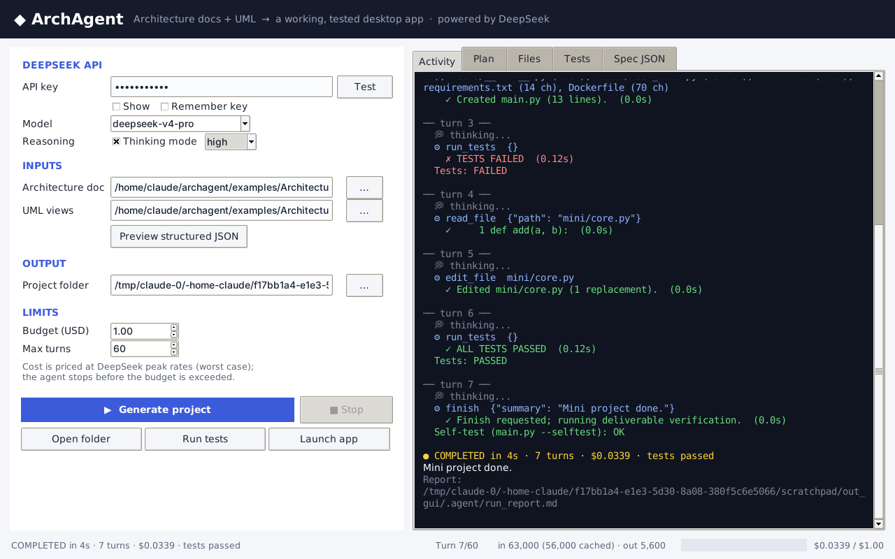

# ArchAgent

**A simplified Claude-Code-style coding agent that turns an architecture document and UML views into a working, tested Windows desktop application. It is driven by DeepSeek `deepseek-v4-pro`.**

ArchAgent ships as a double-click Windows `.exe` with a small GUI. The target machine does **not** need Python. You give it:

1. an architecture document (`Architecture_Documentation.md`)
2. the architectural views as PlantUML (`Architecture_View.md`, 4+1 views, 11 diagram types)

The agent then plans, writes, tests and fixes a complete project: source code, `requirements.txt`, `Dockerfile`, `README.md` and unittest test cases. It stops before a hard USD budget is reached (default **$1.00**).



*GUI during an offline test run (scripted LLM). It shows the self-correction loop: a test fails, the agent reads the file, edits it, and the tests pass.*

---

## Download & run (Windows)

1. Download `ArchAgent.exe` from **Releases**, or from the latest **Actions → Build Windows .exe** run (artifact `ArchAgent-windows`).
2. Double-click it. No installer and no Python needed.
3. Paste your DeepSeek API key and press **Test**.
4. The two example inputs are preselected (bundled inside the exe). Choose an output folder.
5. Press **▶ Generate project**. Watch the *Activity*, *Plan*, *Files* and *Tests* tabs live.
6. When it finishes, press **Run tests** or **Launch app** to start the generated game. Both use the interpreter bundled inside the exe.

`ArchAgent-cli.exe` is the same program with a console, for scripted runs:

```bat
set DEEPSEEK_API_KEY=sk-...
ArchAgent-cli.exe cli --doc Architecture_Documentation.md --views Architecture_View.md --out .\space-fractions --budget 1.0
ArchAgent-cli.exe cli --preprocess-only --doc Architecture_Documentation.md --views Architecture_View.md --out .\spec
```

## Free practice mode (no DeepSeek credit needed)

The **Provider** dropdown also offers free, OpenAI-compatible providers, so you can try the agent at no cost:

| Provider | Get a free key | Notes |
|---|---|---|
| **DeepSeek (official)**, the default | platform.deepseek.com | **Required for the evaluation submission** (`deepseek-v4-pro`) |
| OpenRouter, free models | openrouter.ai/keys | `...:free` models, about 20 requests/min and 50/day; pick a model that supports tool calling |
| Google Gemini, free tier | aistudio.google.com/apikey | Flash / Flash-Lite models |
| Custom | none | any OpenAI-compatible endpoint, e.g. Ollama at `http://localhost:11434/v1` |

On a non-DeepSeek provider, DeepSeek-only fields (`thinking`, `reasoning_content`) are not sent, cost is reported as $0, and the run report is labelled as a practice run.

## GUI

| Area | What it does |
|---|---|
| **LLM provider** | provider (DeepSeek official or a free practice provider), API key (masked; stored only if *Remember key* is ticked), *Test* = tiny ping, model, base URL, thinking mode + effort |
| **Inputs** | architecture document + UML views file pickers; *Preview structured JSON* shows the preprocessed spec |
| **Output** | project folder |
| **Limits** | USD budget (hard cap) and max turns |
| **Generate / Stop** | runs the agent in a background thread; Stop takes effect after the current step |
| **Open folder / Run tests / Launch app** | post-run actions, executed with the exe's bundled Python |
| Tabs | *Activity* (reasoning, tool calls, results), *Plan* (agent's todo list), *Files* (tree + preview), *Tests*, *Spec JSON* |
| Status bar | turn counter, cached / uncached / output tokens, live cost bar against the budget |

## How it works

```
 Architecture_Documentation.md ─┐   deterministic, 0 tokens        ┌─────────── agent loop (DeepSeek v4-pro, thinking) ───────────┐
                                ├─► preprocess ─► spec.json ─────► │ todo_write → write_files → run_tests → read/edit_file → ... │
 Architecture_View.md (PlantUML)┘   (Markdown + 11 UML parsers)    │        ▲ tool results            budget guard, compaction  │
                                                                   └────────┴──────────────── verification gate ─► finish ───────┘
                                                                                     │
                                                         output/ project + .agent/{spec.json, transcript.jsonl, run_report.md}
```

1. **Preprocessing (no LLM).** `archagent/preprocess/` parses the Markdown into sections, tables, requirements, components, tech stack and deliverables. It parses every PlantUML block (use case, class, object, state, activity, sequence, collaboration, package, component, deployment, container) into JSON. A cross-view **digest** pulls out the contract the code must honour: entities with attributes and operations, relations, the state machine, scenarios, use cases and requirements. The model starts from grounded, structured facts instead of re-parsing UML text.
2. **Agent loop.** A single loop: the model decides, the harness runs tools and feeds results back. There are 10 tools: `todo_write`, `list_files`, `read_file`, `search_files`, `write_file`, `write_files`, `edit_file`, `run_tests`, `run_python`, `finish`.
3. **Verification gate.** `finish` is only accepted when `main.py`, `README.md`, `requirements.txt`, `Dockerfile` and `tests/test_*.py` exist **and** the test suite passes. If files changed since the last test run, the harness re-runs the tests itself at zero token cost.
4. **Final checks and report.** The harness runs the tests and `main.py --selftest`, then writes `.agent/run_report.md` with tokens, cost, turns and results.

See **[docs/DESIGN.md](docs/DESIGN.md)** for how each mechanism maps to Claude Code's design.

### Mechanisms adopted from Claude Code (simplified)

| Claude Code mechanism | ArchAgent implementation |
|---|---|
| Main agent loop with recoverable errors | `agent/loop.py`: tool errors, bad JSON and unknown tools become *results*; a token-limit cut-off triggers a "split it" message |
| Unified tool interface + permission pipeline | `agent/tools.py`: one `Tool` dataclass; every path is resolved inside the output folder (sandbox); `.agent/` is reserved |
| Search-and-replace editing, read-before-edit, unique match | `edit_file` refuses unread files and ambiguous `old_string` |
| TodoWrite planning | `todo_write` (only one item `in_progress`), shown live in the *Plan* tab |
| Context compaction: trim large old outputs first | `agent/context.py`: old tool outputs and old file bodies are stubbed; the cached prefix and `reasoning_content` are untouched |
| Prompt caching | system prompt + spec message are byte-identical every turn, so DeepSeek's prefix cache serves most input at about 1/30 of the price |
| Layered system prompt | `agent/prompts.py`: identity → environment → workflow → quality bar → deliverables |
| Observability | live events in the GUI + `transcript.jsonl` + `run_report.{md,json}` |

## Cost control (< $1 with DeepSeek)

* Pricing table for `deepseek-v4-pro` (cache hit / miss / output, peak and off-peak) is in `llm/pricing.py`. Costs are computed from the API's real `usage` fields, at **peak (worst-case) rates** by default.
* Before every call the guard estimates the next request from the previous request's real token count. It stops if the call could cross the budget, and it caps `max_tokens` to the money left.
* The model is warned when only about 7 calls of budget remain, and told to wrap up at about 3.
* Cost-saving design choices: zero-token preprocessing; a stable, cache-friendly prompt prefix; batched `write_files`; small `edit_file` fixes; free harness-side test runs; output truncation; context compaction.
* Estimated full run: **≈ $0.30 off-peak / ≈ $0.60 peak**. The real figure for every run is in `.agent/run_report.md`.

## What the generated project looks like

The system prompt pins the target to a **Python 3.12 + Tkinter desktop app, standard library only**, so it runs on the interpreter inside the exe. The architecture document's server-side choices are mapped onto that target, and the generated README documents the mapping:

| Spec (microservices) | Desktop implementation |
|---|---|
| GameComponent / QuestionComponent / UserComponent / AdminComponent | Python packages with service classes exposing the same operations |
| REST / gRPC contracts | in-process service interfaces (OpenAPI/proto kept under `docs/architecture/`) |
| PostgreSQL | SQLite with the same tables (durability, ASR-1) |
| Redis cache | in-memory cache |
| OAuth2 | local admin login with PBKDF2-hashed passwords (ASR-2) |

Required in every generated project: `main.py` (GUI) with `--selftest` (headless smoke check), a domain layer separate from the GUI, an explicit state machine (Playing ⇄ Paused → GameOver), SQLite persistence, an admin question editor, help and score screens, `tests/` (unittest, no windows), `requirements.txt`, `Dockerfile`, a `README.md` with a traceability matrix, and the document's own deliverables under `docs/architecture/`.

## Build from source

```bat
:: on Windows (Python only needed on the BUILD machine)
packaging\build_windows.bat
```

This runs the tests, then `pyinstaller packaging/ArchAgent.spec` to produce `dist/ArchAgent.exe` (GUI) and `dist/ArchAgent-cli.exe` (console).
CI does the same on `windows-latest` for every push (`.github/workflows/build-windows.yml`). It also smoke-tests the frozen exe: preprocessing, running a unittest suite and a `--selftest` with the bundled interpreter. Pushing a tag `v*` attaches both executables to a GitHub Release.

Run from source on any OS: `python -m archagent` (GUI) or `python -m archagent cli ...`.

## Tests

```bash
pip install -r requirements-dev.txt
python -m pytest -q        # 77 tests, no network, no API key needed
```

The tests cover the Markdown and PlantUML parsers (all 11 diagram kinds), the spec digest, tool sandboxing and edit rules, the DeepSeek client against a local fake HTTP server (thinking payload, retries, 401/402 handling), cost math and peak windows, and the full agent loop with a scripted LLM. Loop scenarios include the happy path, the verification gate, harness-side test re-runs, the budget guard, max turns, stop, LLM errors, token-limit recovery and compaction. They also cover running generated code (layouts, syntax errors, timeouts, sandbox) and settings that never leak the key.

## Project layout

```
archagent/
  __main__.py            entry: GUI | cli | --child (internal runner)
  cli.py                 headless CLI
  config.py              settings (%APPDATA%\ArchAgent\settings.json)
  preprocess/            markdown_parser.py, plantuml_parser.py, spec_builder.py
  llm/                   client.py (DeepSeek, stdlib urllib), pricing.py (cost tracker)
  agent/                 loop.py, tools.py, prompts.py, context.py
  runtime/runner.py      runs generated tests/scripts with the bundled interpreter
  gui/app.py             Tkinter desktop UI
examples/                the two task input files (bundled into the exe)
packaging/               PyInstaller spec, icon, build_windows.bat
tests/                   pytest suite + fakes (scripted LLM, fake DeepSeek server)
docs/                    DESIGN.md, VIDEO_SCRIPT.md
```

## References

* Claude Code: https://github.com/anthropics/claude-code
* How Claude Code works (architecture analysis): https://github.com/Windy3f3f3f3f/how-claude-code-works
* claw-code (open-source agent harness): https://github.com/ultraworkers/claw-code
* DeepSeek API: [pricing](https://api-docs.deepseek.com/quick_start/pricing), [thinking mode & tool calls](https://api-docs.deepseek.com/guides/thinking_mode)

## License

MIT
